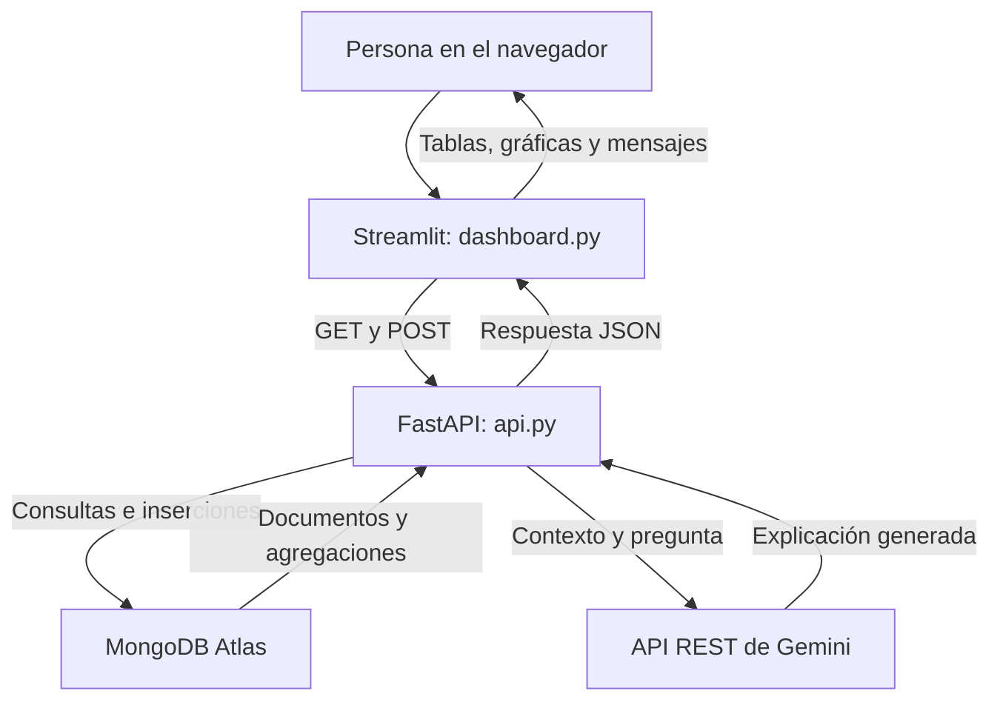

<a id="proyecto"></a>

# Explorador de exoplanetas

### Proyecto final de Programación Aplicada

**Consulta de datos, análisis científico, visualización e inteligencia artificial.**

El proyecto transforma el catálogo de exoplanetas trabajado en el segundo corte en una aplicación web. La información permanece en MongoDB Atlas y se consulta mediante una API propia. El dashboard permite explorar registros, aplicar filtros, interpretar gráficas y agregar capturas manuales. Gemini incorpora respuestas en lenguaje natural sobre los datos seleccionados.

**Objetivo:** integrar almacenamiento, programación y análisis en un recorrido completo, desde la solicitud del usuario hasta un resultado verificable.

[Dashboard público](https://exoplanetasproyecto.streamlit.app/) · [API y documentación](https://exoplanetas-api-juanfmarbo.onrender.com/docs) · [Repositorio](https://github.com/Juanfmarbo/First-API)

**Contenido:** [Proyecto y datos](#proyecto) · [API](#api) · [Análisis](#analisis) · [Dashboard](#dashboard) · [Gemini](#gemini) · [Despliegue y resultados](#despliegue)

---

## 1. Las preguntas que organizan el análisis

Un exoplaneta es un planeta exterior al sistema solar. El catálogo reúne características que permiten comparar tamaños, energía recibida, distancias, temperaturas y métodos de descubrimiento.

| Pregunta del proyecto | Información utilizada | Resultado |
|---|---|---|
| ¿Cuántos planetas parecidos a la Tierra conocemos? | Radio, insolación e indicadores de límites. | Candidatos, evaluables y porcentaje. |
| ¿Qué tan lejos están y cuánto tardaríamos en llegar? | Distancia de los candidatos y velocidad hipotética. | Cercanía y tiempo idealizado de viaje. |
| ¿Qué tan lejos puede “ver” cada método? | Método de descubrimiento y distancia conocida. | Comparación de mínima, mediana y máxima. |
| ¿Qué tan extremos pueden ser los planetas? | Temperatura, período orbital, masa e indicadores. | Casos por criterio y por método. |

Los filtros cambian la población que se analiza. Cada resultado corresponde a los documentos que coinciden con la selección activa.

---

## 2. Arquitectura de la aplicación



El **frontend** presenta la información y recibe las acciones del usuario. Streamlit construye esa interfaz mediante Python; el navegador la muestra.

El **backend** aplica las reglas del proyecto. FastAPI recibe solicitudes, valida entradas, consulta MongoDB, calcula estadísticas y prepara las preguntas de IA.

La separación concentra las reglas en un lugar: el catálogo, las gráficas y Gemini utilizan los mismos filtros y criterios del backend. La conexión privada con MongoDB se encuentra en la API.

---

## 3. Herramientas utilizadas y razón de elección

| Herramienta | Versión del proyecto | Función y razón de uso |
|---|---|---|
| FastAPI | 0.162.0 | Define rutas HTTP, interpreta parámetros y genera documentación desde las declaraciones de Python. |
| Uvicorn | 0.54.0 | Ejecuta la aplicación FastAPI como servidor que atiende solicitudes. |
| PyMongo | 4.19.0 | Conserva la conexión y las operaciones sobre los documentos del segundo corte. |
| Streamlit | 1.66.1 | Construye filtros, formularios, tablas y gráficas con Python. |
| pandas | 3.1.0 | Organiza las respuestas JSON en tablas y prepara columnas para visualización y CSV. |
| Requests | 2.34.2 | Comunica Streamlit con nuestra API y nuestra API con Gemini mediante HTTP. |
| python-dotenv | 1.2.4 | Carga configuración local sin incorporar credenciales al código. |

Son las siete dependencias directas de [requirements.txt](requirements.txt). La integración de Gemini reutiliza Requests.

Pydantic llega con FastAPI y valida los modelos de entrada. `certifi` llega con Requests y aporta certificados de confianza. `json`, `math`, `os`, `re`, `datetime`, `pathlib`, `statistics` y `typing` forman parte de Python. La versión utilizada en la validación del proyecto es **Python 3.12**.

---

## 4. Organización del código y la configuración

| Archivo | Responsabilidad |
|---|---|
| [api.py](api.py) | Acceso a MongoDB, adaptación de esquemas, filtros, estadísticas, creación de registros e integración con Gemini. |
| [dashboard.py](dashboard.py) | Interfaz, solicitudes HTTP, preparación de tablas, gráficas, formulario y estado de sesión. |
| [requirements.txt](requirements.txt) | Versiones fijadas de las bibliotecas directas. |
| [.env.example](.env.example) | Nombres de variables y valores de ejemplo sin credenciales. |
| [.gitignore](.gitignore) | Exclusión de configuración privada, entornos y archivos generados. |
| [.python-version](.python-version) | Declaración de Python 3.12. |
| [render.yaml](render.yaml) | Plantilla de configuración del servicio web de la API. |
| [.devcontainer/devcontainer.json](.devcontainer/devcontainer.json) | Entorno de desarrollo de VS Code/Codespaces, separado del alojamiento público. |

Las funciones separan operaciones que se reutilizan: construir una consulta, normalizar un documento, preparar una tabla o enviar una petición. La indentación de Python delimita los bloques; los ejemplos de esta presentación mantienen cuatro espacios por nivel.

---

## 5. MongoDB: base, colección y documentos

**Atlas** aloja MongoDB. Dentro del cluster, la base `proyecto_segundo_corte` contiene las colecciones del proyecto. Cada documento representa un registro con nombres, medidas, indicadores y procedencia.

La aplicación utiliza los datos limpios que quedaron del segundo corte. No vuelve a descargar automáticamente el catálogo de NASA cada vez que se abre el dashboard.

**Ejemplo sintético de estructura de un documento:**

```json
{
  "planeta": "DEMO-001",
  "estrella": "Estrella de demostración",
  "metodo_descubrimiento": "Transit",
  "anio_descubrimiento": 2026,
  "radio_tierras": 1.2,
  "limite_radio": 0,
  "insolacion_tierra": 1.0,
  "limite_insolacion": 0,
  "fuente": {
    "nombre": "Registro manual del proyecto"
  }
}
```

`fuente` es un objeto anidado. MongoDB permite consultar su contenido con `fuente.nombre`. En los registros creados por la API, la procedencia manual la establece el servidor; no forma parte de los campos aceptados del POST.

---

## 6. Campos, unidades y datos desconocidos

| Grupo | Campos y significado |
|---|---|
| Identificación | `_id`, `planeta` y `estrella`: identidad del documento y nombres. |
| Descubrimiento | `metodo_descubrimiento`, `anio_descubrimiento` y `lugar_descubrimiento`. |
| Tamaño y energía | `radio_tierras`, en radios terrestres; `insolacion_tierra`, relativa al flujo terrestre. |
| Distancia | `distancia_sistema_parsec`, en parsecs. |
| Temperatura y órbita | `temperatura_planeta_k`, en kelvin; `periodo_orbital_dias`, en días. |
| Masa y densidad | `masa_tierras`, en masas terrestres; `densidad_planeta`, en g/cm³. |
| Referencias | `tipo_masa`, `referencia_radio`, `fuente.nombre` y `fuente.tabla`. |
| Indicadores | `limite_radio`, `limite_insolacion`, `limite_temperatura`, `limite_periodo` y `limite_masa`. |

Los indicadores tienen cuatro interpretaciones: **`0` valor puntual, `1` límite superior, `-1` límite inferior y `null` desconocido**. El indicador `0` no significa que la magnitud física valga cero.

Una magnitud desconocida se representa como `None` en Python y `null` en JSON. Reemplazarla por cero alteraría los análisis: una temperatura ausente podría terminar clasificada como extremadamente baja.

Los registros del catálogo conservan sus referencias originales. `origen_del_radio` identifica la marca textual de un valor calculado por el archivo; no vuelve a calcularlo ni garantiza que toda referencia restante sea una medición directa.

Fuente de unidades y definiciones: [NASA Exoplanet Archive](https://exoplanetarchive.ipac.caltech.edu/docs/API_PS_columns.html). Esquema aplicado: [api.py](api.py).

---

<a id="api"></a>

## 7. API: solicitudes HTTP y respuestas JSON

La API concentra las reglas del proyecto. Recibe una solicitud, consulta o modifica datos y devuelve una respuesta que otros programas pueden interpretar. Streamlit utiliza esta interfaz para trabajar con MongoDB sin conectarse directamente a la base.

Una solicitud combina **método**, **ruta**, posibles **parámetros** y, en operaciones como POST, un **cuerpo**:

```http
GET /datos?metodo=Transit&pagina=2&por_pagina=25
```

| Parte | Significado en el ejemplo |
|---|---|
| `GET` | Operación de lectura. |
| `/datos` | Ruta que devuelve registros. |
| `metodo=Transit` | Selección por método de descubrimiento. |
| `pagina=2&por_pagina=25` | Segunda página, con hasta 25 documentos. |

Los parámetros aparecen después de `?` y se separan mediante `&`. En `POST /datos`, el registro viaja en el cuerpo JSON. En `POST /preguntar`, el cuerpo contiene una pregunta y los filtros siguen viajando en la URL. El método POST indica procesamiento de una solicitud; no significa necesariamente guardar un planeta.

**JSON** es el formato de intercambio. Un objeto JSON se convierte en un diccionario de Python y un arreglo, en una lista. `None` de Python corresponde a `null` en JSON. Una respuesta también incluye un código HTTP, como `200` para una consulta correcta o `201` para una creación.

La implementación está en [api.py](api.py).

---

## 8. FastAPI, Uvicorn y organización del backend

**FastAPI** define la aplicación, registra rutas e interpreta las entradas. **Uvicorn** ejecuta esa aplicación como servidor HTTP. La expresión `api:app` identifica el módulo `api.py` y su variable `app`.

La instancia `app = FastAPI(...)` contiene el título, la descripción y la versión `1.1.0`. Los decoradores relacionan método y ruta con una función. En este extracto de la declaración de creación:

```python
@app.post("/datos", status_code=201, tags=["Creación"])
def crear_registro(registro: NuevoRegistro):
    ...
```

`@app.post` registra la operación; `status_code=201` define la respuesta de éxito; `tags` organiza la documentación; `registro: NuevoRegistro` declara el modelo del cuerpo. Los puntos representan el cuerpo desarrollado en el archivo.

| Importaciones | Función en el backend |
|---|---|
| `FastAPI`, `Query`, `Depends`, `HTTPException` | Aplicación, parámetros compartidos y respuestas controladas. |
| `BaseModel`, `ConfigDict`, `Field`, `field_validator` | Estructura y validación de las entradas. |
| `MongoClient` y errores de PyMongo | Operaciones sobre la colección y manejo de fallos. |
| `os`, `Path`, `load_dotenv`, `certifi` | Configuración y confianza de certificados. |
| `math`, `datetime`, `median`, `re`, `Literal` | Reglas numéricas, año, estadística, texto y valores permitidos. |
| `json`, `requests` | Serialización y comunicación con Gemini. |
| `Request`, `RequestValidationError`, `JSONResponse` | Solicitudes, errores de entrada y respuestas explícitas. |

FastAPI genera el esquema OpenAPI y la interfaz `/docs` a partir de estas declaraciones. Las rutas usan funciones síncronas; los manejadores de errores usan `async def`.

---

## 9. Conexión con MongoDB y compatibilidad de esquemas

`load_dotenv(Path(__file__).with_name(".env"))` carga la configuración local junto a `api.py`. `os.getenv` lee sus variables y `strip()` elimina espacios exteriores. `MONGO_URI` contiene la conexión privada; `MONGO_DB` selecciona la base; `MONGO_COLLECTION` permite fijar la colección.

`obtener_coleccion()` crea `MongoClient` cuando una operación necesita datos. La variable global `cliente` comienza en `None` y después conserva el cliente para reutilizarlo. Por ello, la documentación y la raíz pueden abrirse antes de disponer de una conexión válida.

Para URI `mongodb+srv://`, `tlsCAFile=certifi.where()` proporciona certificados de confianza. `certifi` es un conjunto de certificados, no un servidor intermediario. Los tiempos de espera son 8 segundos para selección de servidor, 8 para conexión y 15 para operaciones de socket; corresponden a etapas diferentes.

Si no se especifica colección, se busca la primera no vacía en este orden:

1. `exoplanetas_presentacion`.
2. `exoplanetas_clase`.
3. `exoplanetas`.

Una colección explícita tiene prioridad y puede estar vacía. La función reconoce los esquemas `final`, `clase` y `borrador` mediante el primer documento y el nombre de la colección. El nombre también permite reconocer los casos previstos cuando una colección explícita está vacía. `ALIAS_CLASE` relaciona nombres como `metodo_descubrimiento` con `metodo`, o `distancia_sistema_parsec` con `distancia_pc`.

La salida es `coleccion, campos, esquema`: referencia a los datos, traducción de nombres y versión reconocida. Esta adaptación conserva los documentos originales; no constituye una migración ni una validación exhaustiva de toda la colección.

---

## 10. Normalización y reglas reutilizables

`normalizar()` construye un nuevo diccionario con nombres uniformes. Convierte `_id` en texto, limpia espacios de las cadenas, revisa medidas e indicadores y conserva `fuente` como objeto. La limpieza se realiza al preparar la respuesta; los documentos guardados permanecen intactos.

| Función | Regla aplicada |
|---|---|
| `numero_positivo` | Acepta números positivos y finitos; excluye textos, booleanos, cero, negativos, `NaN` e infinitos. |
| `anio_valido` | Exige un número positivo sin parte decimal y devuelve un entero. |
| `es_evaluable` | Exige radio e insolación disponibles y ambos indicadores en `0`. |
| `es_candidato` | Añade los intervalos inclusivos de radio e insolación a la condición anterior. |
| `origen_del_radio` | Clasifica la referencia como calculada por el archivo, otra referencia o ausencia de referencia. |

Los indicadores reconocidos son `-1`, `0`, `1` y ausencia de información. Un indicador desconocido se conserva como `None`; no se transforma en valor puntual. La aplicación tampoco interpreta un booleano como medida: aunque Python relaciona `bool` con `int`, `True` no representa un radio terrestre.

`origen_del_radio` busca el texto `calculated value`, ignorando mayúsculas. Esta función conserva una distinción de procedencia; no vuelve a calcular el radio ni acredita que cualquier otra referencia sea una medición directa.

La normalización permite que las mismas reglas alimenten catálogo, estadísticas y contexto de IA.

---

## 11. Filtros compartidos: de la URL a MongoDB

`recibir_filtros()` valida método, nombre, años, selección de candidatos y procedencia. `Query` establece longitudes y límites; `Literal` restringe el origen a `todos`, `nasa` o `manual`. Un año inicial superior al final produce `422`.

`Depends(recibir_filtros)` entrega ese mismo conjunto validado a las rutas de datos, estadísticas y preguntas. La selección conserva así una interpretación común en las tres operaciones.

`construir_consulta()` transforma las opciones en condiciones de MongoDB. El diccionario inicial `{}` selecciona todos los documentos; los filtros agregan restricciones. Este extracto implementa la búsqueda por nombre:

```python
texto = {"$regex": re.escape(filtros["nombre"]), "$options": "i"}
consulta["$or"] = [{"planeta": texto}, {"estrella": texto}]
```

`re.escape` conserva literalmente los símbolos escritos. `$regex` busca coincidencias parciales, `i` ignora mayúsculas y `$or` acepta coincidencia en planeta o estrella.

| Operación | Uso concreto |
|---|---|
| Igualdad | Método y `fuente.nombre`. |
| `$gte`, `$lte` | Límites inclusivos de años, radio e insolación. |
| Condiciones juntas | Exigen cumplir simultáneamente los filtros activos. |
| Indicadores iguales a `0` | Restringen candidatos a valores puntuales. |

Las consultas operan sobre los valores almacenados; la normalización posterior no modifica retroactivamente cómo MongoDB aplica un filtro.

---

## 12. Rutas de información, salud y opciones

Las rutas GET recuperan información con responsabilidades distintas:

| Ruta y función | Resultado |
|---|---|
| `GET /` → `inicio` | Nombre del proyecto, dirección de documentación y lista de operaciones. |
| `GET /salud` → `salud` | Estado, base, colección, esquema y cantidad de documentos. |
| `GET /opciones` → `opciones` | Métodos, límites de años, cobertura de indicadores y advertencias. |
| `GET /datos` → `listar_datos` | Una página de registros de la selección. |
| `GET /estadisticas` → `estadisticas` | Resumen de toda la selección y resultados de las cuatro preguntas. |

`inicio()` no consulta MongoDB. En cambio, `salud()` obtiene la colección y ejecuta `cliente.admin.command("ping")`: confirma acceso real en ese momento. La respuesta no incluye la URI privada ni comprueba Gemini.

`opciones()` usa `distinct` para obtener métodos y años diferentes. Ordena los métodos, valida los años y calcula su mínimo y máximo. Las opciones proceden de toda la colección, no únicamente de una página.

La cobertura se calcula contando indicadores incluidos en `[-1, 0, 1]` mediante `$in`. Si faltan indicadores necesarios, se incorpora una advertencia. Tener un indicador reconocido no basta para ser evaluable: también hace falta la magnitud correspondiente.

---

## 13. GET de datos: consulta y paginación

`listar_datos()` recibe una página desde `1` y un tamaño entre `1` y `200`, inicialmente `25`. Cuenta todas las coincidencias antes de recuperar la porción solicitada.

Extracto de la consulta:

```python
total = coleccion.count_documents(consulta)
salto = (pagina - 1) * por_pagina

documentos = (
    coleccion.find(consulta)
    .sort([("planeta", 1), ("_id", 1)])
    .skip(salto)
    .limit(por_pagina)
)
datos = [normalizar(documento, campos) for documento in documentos]
```

`find` produce un cursor recorrible. `sort` ordena por nombre y utiliza `_id` para desempatar; `1` indica orden ascendente. `skip` omite documentos y `limit` restringe la cantidad devuelta. La comprensión de lista normaliza cada resultado.

**Ejemplo hipotético:** una selección de 27 registros necesita dos páginas de 25. La primera contiene 25 filas y la segunda, 2. En ambas, `total` permanece en 27.

La respuesta incluye `total`, `pagina`, `por_pagina`, `paginas` y `datos`. `math.ceil(total / por_pagina)` redondea hacia arriba. Sin coincidencias, devuelve total y páginas en cero, con lista vacía. Una página posterior a la última también devuelve una lista vacía.

Conteo y lectura son operaciones separadas: el orden es estable para un conjunto sin cambios, pero inserciones simultáneas pueden desplazar documentos entre páginas.

---

## 14. GET de estadísticas: agregación y cálculo

`estadisticas()` aplica los mismos filtros y utiliza toda la selección. La paginación del catálogo no limita los documentos incluidos en sus cálculos.

MongoDB cuenta registros por método y año mediante agregaciones. Este extracto representa la agrupación por método:

```python
grupos_metodo = coleccion.aggregate([
    {"$match": consulta},
    {"$group": {
        "_id": "$" + campos["metodo_descubrimiento"],
        "conteo": {"$sum": 1},
    }},
    {"$sort": {"conteo": -1, "_id": 1}},
])
```

`$match` filtra; `$group` reúne documentos con el mismo método; `$sum: 1` cuenta una unidad por documento; `$sort` ordena por cantidad descendente y nombre ascendente. Aquí `_id` identifica el grupo, no un planeta individual.

Las agrupaciones utilizan los valores almacenados. Los cálculos en Python recorren documentos normalizados; las claves de año se validan antes de incorporarse a la serie. La agrupación por método no aplica automáticamente la limpieza textual de `normalizar`.

Python obtiene candidatos, distancias, tiempos de viaje, medianas y extremos. La respuesta reúne esos resultados junto con distribuciones y conteos de evaluables. La biblioteca `statistics` aporta `median`; pandas prepara las tablas del dashboard.

La implementación carga la selección en memoria y realiza varias consultas. Ese diseño mantiene explícitas las reglas del análisis, con límites de memoria y concurrencia si el volumen creciera.

---

## 15. Validación del registro: contrato de entrada

`NuevoRegistro` hereda de `BaseModel`. FastAPI utiliza ese modelo para validar el cuerpo antes de ejecutar una inserción. La validación también se aplica a solicitudes que llegan desde Swagger u otro cliente.

| Regla | Implementación |
|---|---|
| Cuatro campos obligatorios | Planeta, estrella, método y año. |
| Textos controlados | Nombres hasta 150 caracteres; método hasta 100; espacios exteriores eliminados. |
| Año entero | `strict=True`, desde `1` hasta `ANIO_ACTUAL`. |
| Medidas opcionales | `float | None`, con `gt=0` cuando se informan. |
| Indicadores | `Literal[-1, 0, 1] | None`. |
| Campos desconocidos | `extra="forbid"`. |
| Valores no finitos | `allow_inf_nan=False`. |

`Field` expresa las restricciones y `ConfigDict` reúne las opciones generales. `default=None` permite omitir magnitudes desconocidas. Lugar y tipo de masa admiten hasta 100 caracteres; referencia de radio, hasta 3.000.

`rechazar_booleanos()` ejecuta un validador con `mode="before"` para medidas e indicadores. Si recibe `True` o `False`, lanza `ValueError`; los demás valores continúan hacia las comprobaciones de Pydantic. El año utiliza modo estricto; el resto de magnitudes no declara esa misma regla de tipos.

La configuración separa ausencia de información, entrada inválida y valor numérico utilizable.

---

## 16. POST de datos: creación y procedencia

`crear_registro()` recibe el modelo validado y obtiene la colección. Antes de guardar, busca un nombre completo igual sin distinguir mayúsculas:

```python
nombre_exacto = "^" + re.escape(registro.planeta) + "$"
existente = coleccion.find_one({
    "planeta": {"$regex": nombre_exacto, "$options": "i"}
})
```

Las anclas `^` y `$` delimitan el nombre completo. Esta comprobación difiere de la búsqueda parcial del catálogo. Si encuentra coincidencia, responde `409`.

`registro.model_dump()` convierte el modelo en diccionario. El backend adapta los nombres al esquema reconocido y establece la procedencia:

```python
documento["fuente"] = {
    "nombre": "Registro manual del proyecto",
    "tabla": "captura_manual",
}
```

El cliente no puede atribuir la captura a NASA mediante este contrato. `insert_one(documento)` realiza la escritura y entrega `inserted_id`. La API devuelve `201`, mensaje, identificador textual y registro normalizado.

La persistencia pertenece a MongoDB: el documento continúa existiendo después de cerrar el navegador. Una consulta posterior permite recuperarlo con origen manual.

La captura de `DuplicateKeyError` también comunica conflictos como `409`. La comprobación previa y la inserción son operaciones separadas; el código no crea un índice único de nombres y no garantiza unicidad atómica ante solicitudes simultáneas.

---

## 17. Respuestas HTTP y manejo de errores

| Código | Significado en las operaciones de datos |
|---:|---|
| `200` | Consulta correcta, incluida una selección vacía. |
| `201` | Registro manual creado. |
| `409` | Conflicto detectado al crear. |
| `422` | Parámetros, cuerpo o combinación de filtros inválidos. |
| `503` | Configuración ausente o una operación de MongoDB no disponible. |

`datos_invalidos()` atiende `RequestValidationError` y conserva `loc`, `msg` y `type`: ubicación, explicación y tipo de problema. El contenido original completo no se devuelve como parte del diagnóstico.

`error_mongodb()` atiende `PyMongoError` con un mensaje controlado. `JSONResponse` fija cuerpo y estado; `HTTPException` interrumpe operaciones cuando el programa detecta una condición conocida. `Request` representa la solicitud que FastAPI entrega al manejador.

Una respuesta de error contiene información para identificar el fallo, no un registro válido. Los detalles pueden ser texto o una lista de problemas; el dashboard diferencia ambas formas. Las excepciones originales y las cadenas privadas de conexión no se incluyen en los mensajes públicos.

Código y referencias: [api.py](api.py), [dependencias de FastAPI](https://fastapi.tiangolo.com/tutorial/dependencies/), [modelos de entrada](https://fastapi.tiangolo.com/tutorial/body/), [configuración de Pydantic](https://docs.pydantic.dev/latest/api/config/) y [consultas de PyMongo](https://www.mongodb.com/docs/languages/python/pymongo-driver/current/crud/query/specify-documents-to-return/).

---

<a id="analisis"></a>

## 18. Primera pregunta: candidatos por radio e insolación

El proyecto define un candidato mediante dos intervalos inclusivos:

$$
0{,}8 \leq R/R_{\oplus} \leq 1{,}6
\qquad
0{,}35 \leq S/S_{\oplus} \leq 1{,}5
$$

`R/R⊕` expresa el radio en unidades terrestres y `S/S⊕` la insolación respecto a la Tierra. Los valores de los extremos también cumplen la condición.

La función `es_evaluable` exige las dos magnitudes disponibles y sus indicadores en `0`. `es_candidato` utiliza esa condición y comprueba los dos intervalos.

| Grupo | Condición |
|---|---|
| Candidato | Es evaluable y cumple ambos intervalos. |
| Evaluable que no cumple | Dispone de la información necesaria, pero alguna magnitud queda fuera. |
| Información insuficiente | Falta una medida válida o un indicador puntual necesario. |

La selección expresa semejanza bajo dos criterios exploratorios. **No demuestra habitabilidad ni presencia de vida.** Atmósfera, agua y otras condiciones no se evalúan en este algoritmo.

Implementación: `es_evaluable`, `es_candidato` y `estadisticas` en [api.py](api.py).

---

## 19. Porcentaje de candidatos y denominador

El porcentaje se calcula entre los registros que sí se pueden evaluar:

$$
\text{Porcentaje de candidatos}
= \frac{\text{candidatos}}{\text{evaluables}}\times 100
$$

**Ejemplo numérico ilustrativo:** una selección de 100 registros contiene 80 evaluables y 4 candidatos. Su porcentaje es `4 / 80 × 100 = 5 %`; los 20 restantes tienen información insuficiente.

El backend devuelve el porcentaje redondeado a dos decimales. La tarjeta del dashboard lo presenta con un decimal. Si no hay evaluables, el backend devuelve `None` y la pantalla presenta un resultado no calculable.

```python
{
    "porcentaje_candidatos": (
        round(len(candidatos) / evaluables * 100, 2)
        if evaluables else None
    ),
    "sin_informacion": len(datos) - evaluables,
}
```

Este es un extracto de los campos de la respuesta estadística, distribuido en varias líneas para facilitar su lectura. La condición evita dividir entre cero.

La paginación no interviene en la fórmula. Los filtros sí: si la selección contiene únicamente candidatos, el porcentaje describe ese subconjunto y será 100 % cuando no esté vacío.

---

## 20. Segunda pregunta: distancia y tiempo de viaje

La API toma los candidatos con distancia positiva conocida, convierte esa distancia y los ordena de menor a mayor.

$$
d_{\text{años luz}} = d_{\text{parsecs}}\times 3{,}26
$$

El escenario de viaje usa una velocidad constante de **17 km/s**:

$$
t_{\text{años}}
=d_{\text{años luz}}\times\frac{299\,792{,}458}{17}
$$

Un año luz es una unidad de distancia. Al multiplicar esa distancia por la razón entre la velocidad de la luz y la velocidad de viaje, el resultado se expresa en años. La misma relación surge de dividir kilómetros entre km/s y convertir segundos a años.

La API añade `distancia_anios_luz`, `viaje_anios` y `origen_radio` a copias de los documentos; esos cálculos no se guardan como nuevas medidas en MongoDB. `cercanos` contiene hasta diez candidatos, mientras `candidatos_con_distancia` informa cuántos cumplen la condición en toda la selección.

El resultado es un **modelo idealizado**: no incluye aceleración, frenado, trayectoria ni desarrollo tecnológico futuro. Expresa la escala de las distancias bajo una velocidad explícita.

---

## 21. Tercera pregunta: comparación por método

La función `estadisticas` convierte las distancias válidas a años luz y las reúne en un diccionario de listas, una lista por método. Cada lista produce cantidad, mínima, mediana y máxima.

| Medida | Operación | Interpretación |
|---|---|---|
| Cantidad | `len(valores)` | Distancias válidas que respaldan la comparación. |
| Mínima | `min(valores)` | Registro más cercano del grupo. |
| Mediana | `median(valores)` | Centro de las distancias ordenadas. |
| Máxima | `max(valores)` | Registro más lejano del grupo. |

En un ejemplo ilustrativo con distancias `10, 12, 100`, la mediana es `12` y la máxima `100`. Si hay una cantidad par de valores, la mediana es el promedio de los dos centrales.

La mediana describe el centro del conjunto; la máxima permite identificar su extremo observado. El dashboard permite alternar entre ambas para comparar métodos.

Los resultados utilizan todos los registros filtrados con método y distancia disponibles. **Describen las distancias registradas en esa selección**, sin establecer por sí solos el alcance físico de un instrumento o la superioridad general de un método.

---

## 22. Cuarta pregunta: planetas extremos

| Categoría | Magnitud y condición | Requisito de evaluación |
|---|---|---|
| Infierno | Temperatura `> 2000 K`. | Temperatura válida, indicador `0`, método conocido y distinto de `Imaging`. |
| Congelado | Temperatura `< 100 K`. | Los mismos requisitos térmicos. |
| Relámpago | Período `< 1 día`. | Período válido e indicador `0`. |
| Supergigante | Masa `> 13 × 317,8 = 4131,4` masas terrestres. | Masa válida e indicador `0`. |

Las desigualdades son estrictas: un período de exactamente un día no cumple Relámpago. Infierno y Congelado comparten el mismo conjunto térmico evaluable; período y masa tienen sus propios requisitos.

En los registros NASA, `temperatura_planeta_k` procede de `pl_eqt`: una temperatura de equilibrio modelada o, para imagen directa, una temperatura efectiva. Esa diferencia explica la exclusión de `Imaging` en las comparaciones térmicas. No se interpreta como una medición general de la superficie. [Definición original](https://exoplanetarchive.ipac.caltech.edu/docs/API_PS_columns.html).

Internamente, cada criterio produce `None` si no se puede evaluar, `False` si se evalúa y no cumple, o `True` si cumple. Los porcentajes usan los evaluables correspondientes.

Un planeta puede pertenecer a varias categorías. `planetas_con_extremos` aumenta una sola vez cuando `any(...)` encuentra al menos un criterio verdadero; sumar los cuatro conteos puede contar un planeta varias veces.

---

<a id="dashboard"></a>

## 23. El dashboard: una interfaz construida con Python

El dashboard reúne consulta, análisis, captura y preguntas de IA en una página. [dashboard.py](dashboard.py) se ejecuta en el servidor de Streamlit; el navegador presenta sus componentes. Las solicitudes salen de ese proceso hacia FastAPI. El acceso directo a MongoDB permanece en [api.py](api.py).

La configuración separa la dirección del backend del resto de la interfaz:

```python
load_dotenv()
API = os.getenv("API_BASE_URL", "http://localhost:8000").rstrip("/")
ANIO_ACTUAL = datetime.now().year
```

`load_dotenv` carga variables locales; `os.getenv` obtiene la dirección; `rstrip` elimina barras finales para unir correctamente las rutas. `datetime` aporta el año vigente. `math` permite calcular páginas y comprobar números finitos. Los alias `pd` y `st` identifican pandas y Streamlit.

`st.set_page_config` define título, icono y distribución ancha. Tres diccionarios traducen la información interna a elementos legibles:

| Diccionario | Transformación |
|---|---|
| `ORIGENES` | Etiquetas visibles → `todos`, `nasa` o `manual`. |
| `INDICADORES` | Etiquetas de límites → `None`, `0`, `1` o `-1`. |
| `NOMBRES_COLUMNAS` | Campos internos → títulos con unidades. |

Esta organización conserva nombres uniformes en la API y etiquetas comprensibles en pantalla.

---

## 24. Comunicación HTTP y manejo de respuestas

`pedir_api(ruta, parametros=None, registro=None, espera=20)` concentra la comunicación. Utiliza GET cuando no hay cuerpo y POST cuando recibe un diccionario en `registro`.

```python
if registro is None:
    respuesta = requests.get(
        f"{API}{ruta}", params=parametros, timeout=espera
    )
else:
    respuesta = requests.post(
        f"{API}{ruta}", params=parametros, json=registro, timeout=espera
    )
```

`params` codifica los filtros en la URL. `json` convierte el diccionario al cuerpo JSON de la solicitud. La misma función permite consultar estadísticas, crear registros y enviar preguntas: un POST no significa necesariamente insertar un planeta.

La respuesta se procesa con `respuesta.json()`. El resultado esperado es un diccionario de Python; si falla la conexión, el formato o la operación, la función muestra un mensaje y devuelve `None`.

| Situación | Comportamiento de la interfaz |
|---|---|
| Espera agotada o conexión fallida | Mensaje de conexión y fin de la operación. |
| `409` | Informa que el nombre ya existe. |
| `422` | Informa entradas inválidas y, cuando llegan, sus campos concretos. |
| `503` en las rutas de datos | Informa indisponibilidad de acceso a la base. |
| Error en `/preguntar` | Presenta el detalle textual controlado por el backend. |

El tiempo habitual es 20 segundos y para IA es 60. Son límites de espera de conexión/lectura de Requests, no un cronómetro exacto de toda la operación. El código no realiza reintentos automáticos.

---

## 25. De documentos JSON a tablas legibles

`preparar_tabla` transforma una lista de registros en un DataFrame, una tabla de filas y columnas de pandas:

```python
tabla = pd.json_normalize(registros)
presentes = [columna for columna in columnas if columna in tabla.columns]
return tabla[presentes].rename(columns=NOMBRES_COLUMNAS)
```

`json_normalize` aplana objetos anidados: `fuente.nombre` se convierte en una columna. La comprensión de lista conserva únicamente columnas existentes y mantiene el orden solicitado. `rename` aplica los títulos visibles. Estas operaciones preparan la presentación y no modifican MongoDB.

La función `numero` aplica separadores habituales en español. Por ejemplo, `numero(1234.56, 2)` produce `1.234,56`. El formato redondea el texto mostrado, mientras el valor original conserva sus decimales.

| Valor recibido | Presentación |
|---|---|
| `None` | «Sin dato». |
| `0` | Cero, como valor conocido. |
| Número decimal | Texto con la cantidad de decimales solicitada. |

`st.dataframe` presenta las tablas, `st.metric` destaca indicadores y las funciones gráficas de Streamlit representan las columnas preparadas con pandas. El cálculo principal de las estadísticas pertenece al backend.

---

## 26. Filtros, estado de sesión y ejecución de la pantalla

Streamlit reconstruye la pantalla ejecutando el archivo de arriba abajo cuando una interacción dispara una nueva ejecución. `st.session_state` conserva la selección activa, la página y ciertos resultados dentro de la sesión.

El flujo principal consulta `/opciones`, obtiene métodos y años, muestra advertencias y construye la barra lateral. Si faltan opciones o estadísticas por un error, `st.stop()` termina esa ejecución.

`st.form` reúne nombre, método, procedencia, candidatos e intervalo de años. Los cambios se aplican juntos al pulsar **Aplicar filtros**. Un intervalo invertido produce un mensaje y conserva la selección anterior. Un envío válido actualiza filtros, vuelve a página 1 y elimina la respuesta anterior de IA.

Las cuatro métricas distinguen colección completa, selección, evaluables y candidatos. Solo la primera ignora los filtros. Las pestañas organizan las funciones:

| Pestaña | Función |
|---|---|
| Preguntas del proyecto | `mostrar_preguntas`. |
| Catálogo | `mostrar_catalogo`. |
| Agregar registro | `mostrar_formulario`. |
| Pregúntale a tus datos | `mostrar_ia`. |

Con el uso actual de `st.tabs`, los cuatro contenidos se ejecutan aunque algunos estén ocultos. La generación de IA y la creación están condicionadas al envío de sus formularios.

Un filtro por método sigue este recorrido: widget → selección activa → GET `/estadisticas` → cálculo del backend → diccionario → DataFrame → gráfica. El catálogo realiza además GET `/datos` con su paginación.

---

## 27. Gráficas de candidatos y distancias cercanas

`mostrar_preguntas(resumen)` recibe el resumen de toda la selección. La primera gráfica se construye con tres categorías:

```python
clasificacion = pd.DataFrame({
    "Resultado": [
        "Cumplen ambos criterios",
        "No cumplen ambos",
        "Sin información suficiente",
    ],
    "Planetas": [
        candidatos,
        evaluables - candidatos,
        resumen["sin_informacion"],
    ],
})
```

`Resultado` ocupa el eje categórico y `Planetas` determina la altura de las barras. Las categorías son excluyentes: su suma corresponde al total seleccionado. Las barras separan incumplimiento e información insuficiente, dos situaciones diferentes.

La métrica complementaria divide candidatos entre evaluables. Un ejemplo hipotético de 2 candidatos entre 10 evaluables produce 20 %, aunque existan otros 5 registros insuficientes. Si no hay evaluables, aparece «No calculable». El filtro de candidatos puede producir 100 % porque ya restringió la selección.

La segunda gráfica presenta **hasta diez candidatos con menor distancia conocida**. Utiliza `Planeta` como categoría y `Distancia (años luz)` como magnitud:

```python
st.bar_chart(
    tabla, x="Planeta", y="Distancia (años luz)",
    horizontal=True, sort=False,
)
```

La orientación horizontal facilita leer los nombres; `sort=False` conserva el orden de cercanía preparado por la API. La tabla añade tiempo de viaje, radio, insolación y procedencia. El número total de candidatos con distancia puede superar las diez filas. Si no hay distancias disponibles, aparece un mensaje en lugar de una distancia cero ficticia.

---

## 28. Gráficas por método y categorías extremas

Para comparar métodos, el dashboard convierte `distancias_por_metodo` en un DataFrame. `st.radio` permite elegir **mediana** o **máxima**; `sort_values(medida)` ordena la gráfica según esa elección. Las barras horizontales comparan distancias en años luz.

La mediana describe el centro; la máxima identifica el caso más lejano. La tabla incluye además mínima y cantidad de datos, conservando el orden original por máxima descendente. Esta comparación describe registros observados, no una superioridad universal del método.

Los extremos se presentan con una tabla de casos, evaluables y porcentajes. `zip` empareja cada conteo con su denominador; cuando este vale cero, el porcentaje queda desconocido.

| Resultado visual | Información que aporta |
|---|---|
| Tabla por criterio | Casos y población evaluable de Infierno, Relámpago, Congelado y Supergigante. |
| Selector de extremo | Categoría que se compara entre métodos. |
| Barras por método | Cantidades absolutas de casos. |
| Tabla complementaria | Casos, evaluables y proporciones de cada método. |

`merge(..., on="Método", how="left")` une las tablas de casos y denominadores. Tener más casos no implica mayor proporción: 20 de 100 son 20 %, mientras 10 de 20 son 50 %.

Las categorías pueden superponerse. `planetas_con_extremos` cuenta cada planeta una vez; sumar las cuatro categorías puede contar varias veces el mismo objeto. Los extremos térmicos excluyen `Imaging` y todos los criterios conservan las reglas de validez de sus medidas.

---

## 29. Catálogo, páginas y exportación

`mostrar_catalogo` permite elegir 25, 50 o 100 filas. Calcula el número de páginas redondeando hacia arriba y mantiene una página seleccionable aunque no existan coincidencias. Si cambia el tamaño y la página actual queda fuera del intervalo, la ajusta antes de dibujar el selector.

```python
parametros = dict(filtros)
parametros.update({"pagina": int(pagina), "por_pagina": cantidad})
respuesta = pedir_api("/datos", parametros=parametros)
```

La copia evita incorporar paginación a los filtros generales de estadísticas e IA. La tabla identifica fuente y tabla de origen; su leyenda diferencia filas visibles y coincidencias totales.

El CSV contiene **la página y las columnas visibles**:

```python
data=tabla.to_csv(index=False).encode("utf-8-sig")
```

`index=False` elimina el índice técnico de pandas y `utf-8-sig` facilita reconocer acentos en programas como Excel. Un desplegable muestra todos los campos de esos mismos registros.

Otro desplegable utiliza el resumen completo para las distribuciones: barras por método y una línea de conteos ordenados por año. La línea sigue un eje temporal; cuenta registros actuales con año conocido, sin reconstruir el contenido histórico del archivo. El año vigente puede estar incompleto.

---

## 30. Formulario y validación de medidas

`mostrar_formulario` reúne cuatro campos obligatorios: planeta, estrella, método y año. El método puede seleccionarse de la lista o escribirse; el texto escrito tiene prioridad. `st.form` evita interpretar cada edición como una escritura.

Los desplegables organizan radio e insolación, distancia y período, temperatura, masa, densidad y referencias. `campo_medida` construye de forma reutilizable cada entrada numérica y su indicador cuando corresponde:

```python
valor = st.number_input(
    etiqueta, min_value=0.0, value=None, step=0.01,
    format="%.6f", key=f"nuevo_{clave}",
)
```

`value=None` comienza sin medición; las claves distinguen los widgets. El formato muestra seis decimales sin afirmar precisión científica. La función devuelve la pareja `valor, indicador`; distancia y densidad no incorporan selector de límite.

Al enviar, la interfaz retira espacios, comprueba textos obligatorios y exige que cada medida informada sea finita y estrictamente positiva. Aunque el widget permite introducir cero, la validación lo rechaza. Una medida desconocida permanece como `None`.

El diccionario combina identificación, textos opcionales, magnitudes e indicadores mediante `**magnitudes` y `**indicadores`. Se envía con `pedir_api("/datos", registro=registro)`. Pydantic repite la validación en el backend, que establece la fuente manual. La validación de pantalla agiliza la interacción; la del servidor también protege las peticiones realizadas desde otros clientes.

---

## 31. Del registro guardado a una nueva selección

Una respuesta satisfactoria del POST guarda en la sesión el mensaje y el nombre recién creado:

```python
st.session_state["buscar_recien_creado"] = registro["planeta"]
st.rerun()
```

`st.rerun()` interrumpe la ejecución y vuelve a iniciar el archivo. Antes de reconstruir los widgets, el flujo principal aplica estos cambios:

- Búsqueda por el nombre nuevo y procedencia manual.
- Método en «Todos», candidatos desactivados e intervalo de años desactivado.
- Página 1 y eliminación de la respuesta anterior de IA.

Después consulta estadísticas y catálogo con la nueva selección. Así un filtro previo no oculta la captura. La búsqueda sigue siendo textual y puede incluir otras coincidencias; no equivale a consultar únicamente un identificador.

El mensaje se consume con `pop` y aparece una vez. Los campos del formulario no se vacían automáticamente. El documento queda persistido en MongoDB; el mensaje y los filtros pertenecen al estado de la sesión.

---

## 32. La pregunta de IA dentro del dashboard

`mostrar_ia` utiliza un formulario con texto de hasta 1.000 caracteres. Al enviarlo elimina la respuesta anterior, rechaza una pregunta vacía y mantiene un indicador de espera durante la solicitud:

```python
resultado = pedir_api(
    "/preguntar", parametros=filtros,
    registro={"pregunta": pregunta.strip()}, espera=60,
)
```

Los filtros viajan en la URL y la pregunta en el cuerpo. El backend prepara las estadísticas de toda la selección y hasta treinta ejemplos; esa muestra no equivale necesariamente a la página visible del catálogo.

La interfaz acepta un texto de respuesta no vacío y conserva pregunta, filtros y resultado en `st.session_state`. Presenta la pregunta respondida, el texto, el modelo, el total resumido y el tamaño de muestra.

La respuesta permanece visible en nuevas ejecuciones mientras coincidan los filtros. Cambiar de página no genera otra petición a Gemini. Aplicar filtros, actualizar datos, activar la selección de un registro nuevo o enviar otra pregunta elimina el resultado anterior. Esto conserva la última respuesta de la sesión; no construye un historial conversacional ni guarda un chat en MongoDB.

La pantalla utiliza exclusivamente la API del proyecto: la clave y la llamada a Google corresponden al backend. La división entre cálculo, transporte y presentación se mantiene también en la función de IA.

---

<a id="gemini"></a>

## 33. Inteligencia artificial conectada con el análisis

**Pregúntale a tus datos** incorpora explicaciones en lenguaje natural al explorador. La persona escribe una pregunta; Streamlit la envía a nuestra API; FastAPI prepara el contexto y solicita una respuesta a Gemini.

La integración mantiene el mecanismo REST trabajado en clase: utiliza `requests.post`, un cuerpo JSON y una respuesta HTTP. No requiere un SDK de Google ni otra dependencia directa de inteligencia artificial.

| Etapa | Responsabilidad |
|---|---|
| Streamlit | Captura la pregunta y conserva los filtros aplicados. |
| `POST /preguntar` | Valida, reúne los resultados del proyecto y llama al modelo. |
| Gemini | Genera una explicación a partir del contexto recibido. |
| API y dashboard | Comprueban la respuesta y presentan texto y alcance de los datos. |

Este POST solicita una generación; no crea un planeta. La pregunta y la respuesta tampoco se guardan en MongoDB. El backend mantiene el control de la consulta y de la información enviada a Google. Implementación: [`preguntar` en api.py](api.py) y [`mostrar_ia` en dashboard.py](dashboard.py).

---

## 34. Contrato de entrada: una pregunta y una selección

La clase `Pregunta` define la estructura que acepta la API. Este extracto conserva sus restricciones centrales:

```python
class Pregunta(BaseModel):
    pregunta: str = Field(min_length=1, max_length=1000)
    model_config = ConfigDict(
        extra="forbid",
        str_strip_whitespace=True,
    )
```

`str` establece una entrada de texto. `Field` limita su longitud entre 1 y 1.000 caracteres. La configuración retira espacios exteriores y rechaza propiedades adicionales. Una cadena compuesta únicamente por espacios no constituye una pregunta válida. El modelo completo también contiene un ejemplo para Swagger mediante `json_schema_extra`.

La ruta recibe `p: Pregunta` y `filtros: dict = Depends(recibir_filtros)`. La pregunta viaja en el cuerpo JSON; los filtros viajan en los parámetros de la URL. Por ejemplo:

```http
POST /preguntar?origen=nasa&metodo=Transit
Content-Type: application/json
```

```json
{
  "pregunta": "¿Cuántos candidatos cumplen ambos criterios?"
}
```

Una entrada inválida produce `422` antes de llamar a Google. Después de validar la solicitud, el backend comprueba `GEMINI_API_KEY`; si falta, responde `503` con un mensaje de configuración. Las demás funciones del catálogo no dependen de esa clave.

---

## 35. Contexto: estadísticas completas y ejemplos concretos

La respuesta se apoya en los mismos filtros y cálculos que utiliza el dashboard:

```python
resumen = estadisticas(filtros)
pagina = listar_datos(pagina=1, por_pagina=30, filtros=filtros)
muestra = [registro_para_ia(registro) for registro in pagina["datos"]]
```

Estas son llamadas a funciones dentro de Python. La API no se hace peticiones HTTP a sí misma. `resumen` contiene las estadísticas de toda la selección; `muestra` contiene hasta treinta documentos ordenados por planeta y, en caso de empate, por identificador.

Los treinta ejemplos no constituyen una muestra aleatoria ni sustituyen los totales. La ausencia de un planeta entre ellos tampoco demuestra que no exista en el catálogo. Un filtro por nombre permite concentrar el contexto en ese objeto.

`registro_para_ia` conserva nombre, estrella, método, año, tipo de masa, siete magnitudes y cinco indicadores. Reduce la fuente a su nombre y añade distancia en años luz, viaje y origen del radio cuando esos resultados existen. Omite identificadores internos y referencias extensas. También procesa los candidatos cercanos del resumen.

El contexto reúne cinco elementos: descripción del proyecto, reglas de las cuatro preguntas, filtros, estadísticas completas y ejemplos. Esta estructura vincula cada explicación con una selección identificable.

---

## 36. Instrucciones y datos separados

La petición distingue **instrucciones de la aplicación** y **contenido que se analiza**. `systemInstruction` contiene las reglas de respuesta; `contents` contiene el contexto y la pregunta.

| Regla | Propósito |
|---|---|
| Español claro y extensión aproximada de 250 palabras | Mantener respuestas comprensibles dentro del dashboard. |
| Totales y porcentajes basados en el resumen | Evitar extrapolar los treinta ejemplos. |
| Reconocer información insuficiente | Conservar los límites de la evidencia. |
| Tratar los textos del catálogo como datos | Evitar convertir un campo de un registro en una instrucción del programa. |
| Distinguir NASA, manuales y desconocidos | Mantener la procedencia y el significado científico. |

El prompt se construye así:

```python
prompt = (
    "CONTEXTO DEL PROYECTO:\n"
    + json.dumps(contexto, ensure_ascii=False, allow_nan=False)
    + f"\n\nPREGUNTA: {p.pregunta}"
)
```

`json.dumps` convierte el diccionario en texto JSON. `ensure_ascii=False` conserva legibles los caracteres españoles; `allow_nan=False` impide emitir `NaN` o infinitos. La normalización previa conserva los desconocidos como `None`, representado en JSON por `null`.

Las instrucciones orientan la generación, pero no garantizan exactitud absoluta. Las estadísticas calculadas siguen siendo la referencia comprobable de las cifras.

---

## 37. Solicitud REST a Gemini

La URL combina el servicio `generativelanguage.googleapis.com`, el modelo configurado en `MODELO_IA` y la operación `generateContent`. El valor predeterminado del código es `gemini-3.6-flash`; su acceso depende de la configuración de la cuenta del proveedor.

La llamada central utiliza la misma biblioteca HTTP del dashboard:

```python
r = requests.post(
    url,
    headers={"x-goog-api-key": GEMINI_API_KEY},
    json={
        "systemInstruction": {"parts": [{"text": instrucciones}]},
        "contents": [{"role": "user", "parts": [{"text": prompt}]}],
        "generationConfig": {"maxOutputTokens": 4096},
    },
    timeout=30,
)
```

La clave viaja en la cabecera `x-goog-api-key`. No forma parte del texto analizado por el modelo ni de la URL. `role="user"` identifica el mensaje, y `parts` contiene su texto. La estructura corresponde al endpoint oficial [`generateContent`](https://ai.google.dev/api/generate-content).

`maxOutputTokens` limita el presupuesto de generación: 4.096 tokens no equivalen a 4.096 palabras. El límite puede incluir razonamiento en modelos que lo generan. La extensión aproximada solicitada es una instrucción de estilo.

`timeout=30` limita esperas de conexión y lectura del proveedor. El dashboard utiliza 60 para esta operación, que además consulta y prepara datos. Son límites de espera de red, no cronómetros exactos de todo el proceso.

---

## 38. Respuestas válidas y manejo de errores

Un HTTP exitoso no garantiza que Google haya devuelto texto completo. `extraer_respuesta_ia` comprueba el objeto recibido, la lista `candidates`, el primer candidato, su contenido y sus partes.

La función detecta bloqueos en `promptFeedback.blockReason`. También revisa `finishReason`: acepta `STOP` o ausencia del campo; rechaza `MAX_TOKENS` porque indica una respuesta incompleta. Los demás motivos no admitidos generan un error controlado.

Finalmente reúne los textos no vacíos que no estén marcados como `thought`. Así el resultado visible corresponde a las partes de respuesta final, sin presentar partes de razonamiento interno como contestación.

| Situación | Respuesta de nuestra API |
|---|---:|
| Pregunta inválida o bloqueo comunicado por el modelo | `422` |
| Clave ausente o rechazo de configuración por Google (`400`, `401`, `403`, `404`) | `503` |
| Cuota o frecuencia excedida | `429` |
| Espera de la llamada agotada | `504` |
| Fallo de red, JSON inválido, estructura inesperada o respuesta incompleta | `502` |

Los mensajes públicos se construyen en la aplicación. No se devuelve el cuerpo bruto del proveedor ni el texto completo de excepciones que pudieran contener información privada.

---

## 39. Resultado visible y estado de la interfaz

Cuando la generación es válida, la API devuelve cuatro campos:

| Campo | Contenido |
|---|---|
| `respuesta` | Texto final producido por el modelo. |
| `modelo` | Identificador configurado para la solicitud. |
| `total_registros` | Tamaño de la selección utilizada en el resumen. |
| `tamano_muestra` | Cantidad de ejemplos enviados, hasta treinta. |

`mostrar_ia` agrupa la entrada en `st.form`. El envío activa el indicador **Pensando...** y realiza la petición; escribir en el campo no genera solicitudes por cada carácter.

La interfaz conserva la última pregunta, sus filtros y su respuesta en `st.session_state`. Cambiar de página o de medida gráfica no obliga a generar otra respuesta. Aplicar filtros, actualizar los datos o seleccionar el registro recién creado elimina el resultado anterior. También se elimina al enviar otra pregunta, aunque esa nueva solicitud falle.

La respuesta guardada solo aparece cuando sus filtros coinciden con la selección activa. Esta comprobación evita atribuir una explicación anterior a datos diferentes. El estado pertenece a la sesión de Streamlit; no constituye un historial enviado al modelo ni un chat persistente en MongoDB.

---

## 40. Alcance y decisiones de la integración

Gemini puede relacionar cifras y formular inferencias a partir del contexto. Ante una pregunta sobre llegar a un planeta parecido a la Tierra, puede explicar qué implican la distancia y el tiempo de viaje calculado a 17 km/s. Esos datos no permiten predecir tecnologías futuras ni demostrar habitabilidad.

La aplicación no configura navegación web, herramientas para consultar MongoDB, ejecución de código generado o entrenamiento del modelo. Google recibe una selección de información preparada por nuestro backend, no acceso directo a Atlas.

| Necesidad del proyecto | Decisión implementada |
|---|---|
| Responder sobre la selección actual | Reutilización de los filtros del catálogo y las estadísticas. |
| Conservar totales correctos | Resumen completo acompañado de hasta treinta ejemplos. |
| Explicar criterios y unidades | Reglas de las cuatro preguntas dentro del contexto. |
| Mantener el enfoque REST de clase | Uso de FastAPI, Pydantic y `requests`, sin SDK adicional. |
| Presentar respuestas utilizables | Validación de estructura, finalización y texto. |
| Identificar la procedencia de las cifras | Metadatos de selección y muestra en la respuesta. |

El modelo aporta lenguaje natural; las reglas, consultas y operaciones matemáticas permanecen explícitas en el código del proyecto. Cada generación utiliza la pregunta actual y su contexto, sin modificar la colección.

---

<a id="despliegue"></a>

## 41. Configuración mediante variables de entorno

El mismo programa funciona en local y en la nube porque las direcciones y credenciales se reciben como configuración externa.

| Variable | Proceso que la utiliza | Función |
|---|---|---|
| `MONGO_URI` | API | Conexión privada con Atlas. |
| `MONGO_DB` | API | Base de datos; predeterminado `proyecto_segundo_corte`. |
| `MONGO_COLLECTION` | API | Colección explícita o selección automática cuando está vacía. |
| `GEMINI_API_KEY` | API | Autenticación ante Google. |
| `MODELO_IA` | API | Identificador del modelo; predeterminado `gemini-3.6-flash`. |
| `API_BASE_URL` | Dashboard | Dirección de nuestra API. |

En local, `python-dotenv` carga `.env`. En los servicios públicos, las variables se configuran en el entorno de cada plataforma. Streamlit Cloud recibe `API_BASE_URL` como secreto de nivel raíz en TOML:

```toml
API_BASE_URL = "https://exoplanetas-api-juanfmarbo.onrender.com"
```

La API utiliza la URI de Atlas y la clave de Gemini; el dashboard utiliza la dirección pública del backend. `.gitignore` excluye `.env`, `.streamlit/secrets.toml` y los entornos virtuales. `.env.example` conserva la estructura compartible de la configuración.

---

## 42. Ejecución local: dos procesos conectados

El entorno virtual `venv` contiene el intérprete y las dependencias del proyecto. La instalación de `requirements.txt` permite que API y dashboard utilicen las mismas versiones de bibliotecas.

**Proceso de la API:**

```bash
python -m uvicorn api:app --reload
```

`api:app` identifica el módulo `api.py` y su instancia FastAPI. `--reload` reinicia el proceso al cambiar el código en desarrollo. La API local atiende en el puerto **8000** y publica su documentación en `/docs`.

**Proceso del dashboard:**

```bash
python -m streamlit run dashboard.py
```

Streamlit atiende la interfaz en el puerto **8501**. Sus solicitudes llegan a `API_BASE_URL`, normalmente `http://localhost:8000` durante el trabajo local.

`localhost` identifica la máquina donde se ejecuta el proceso que realiza la petición. Por eso el dashboard alojado en la nube utiliza la URL de Render, mientras el dashboard local puede comunicarse con una API local o con la pública.

---

## 43. Despliegue público y separación de servicios

| Plataforma | Elemento alojado | Responsabilidad |
|---|---|---|
| GitHub | Repositorio `Juanfmarbo/First-API`. | Versiones del código y documentación. |
| MongoDB Atlas | Base y colección de exoplanetas. | Persistencia de documentos. |
| Render | API FastAPI ejecutada por Uvicorn. | Consultas, cálculos, validación, escritura y acceso a Gemini. |
| Streamlit Community Cloud | `dashboard.py`. | Interfaz pública y consumo de la API. |
| Google | Modelo de Gemini. | Generación de texto a partir del contexto enviado. |

El arranque de la API en Render utiliza:

```bash
python -m uvicorn api:app --host 0.0.0.0 --port $PORT
```

`0.0.0.0` permite escuchar en las interfaces del servicio y `$PORT` toma el puerto asignado por la plataforma. Render publica el acceso HTTPS. El dashboard público mantiene su propia URL y llama al backend por esa dirección.

[render.yaml](render.yaml) describe una plantilla de servicio Python, comandos y variables privadas. Su existencia no convierte automáticamente un servicio manual en un Blueprint administrado. El repositorio también conserva un devcontainer con Python 3.11 que inicia Streamlit; ese entorno de desarrollo es diferente del entorno Python 3.12 validado y del despliegue público.

---

## 44. Resultados documentados del catálogo

**Captura de la selección NASA registrada el 8 de noviembre de 2026.**

| Indicador | Resultado |
|---|---:|
| Registros de procedencia NASA | 6.375 |
| Evaluables para radio e insolación | 5.693 |
| Candidatos que cumplen ambos intervalos | 27 |
| Información insuficiente para esa evaluación | 682 |
| Porcentaje de candidatos entre evaluables | 0,47 % |

Estos valores corresponden a esa fecha y selección. La aplicación calcula sus resultados desde la base: un filtro diferente o una modificación de los datos puede cambiar los indicadores.

La integración se verificó con MongoDB local y datos sintéticos, y después con consultas y capturas manuales en los servicios públicos. Las pruebas de IA utilizaron respuestas externas simuladas para comprobar contratos, contexto, errores y estado de la interfaz.

En la comprobación pública de IA del 8 de noviembre, la nueva ruta y pestaña estaban publicadas; la pregunta devolvió el diagnóstico de `GEMINI_API_KEY` ausente. Ese registro acredita el manejo de configuración, no una respuesta real de Google ni el estado posterior de la cuenta.

Evidencia y alcance: [verificación documentada del proyecto](presentacion-sustentacioln.md#verificacion).

---

## 45. Resultado de la integración

El proyecto reúne **consulta, análisis, visualización y creación persistente**. Una selección del usuario se transforma en parámetros HTTP, después en una consulta MongoDB y finalmente en resultados que el dashboard presenta como indicadores, tablas y gráficas.

Las reglas científicas están declaradas en el backend. Los datos insuficientes permanecen identificados, los porcentajes usan sus denominadores y los registros manuales conservan una procedencia diferenciada.

Gemini incorpora explicaciones a partir de estadísticas calculadas y ejemplos limitados. La generación utiliza las mismas reglas y filtros del análisis, con respuestas y errores interpretados por nuestra API.

El alcance actual es académico: lectura y creación, sin rutas de edición o borrado ni autenticación propia. La comprobación previa de duplicados no sustituye un índice único; el cálculo en memoria depende del tamaño de la selección; y el contexto de IA no garantiza por sí solo exactitud en cada frase generada.

**La aplicación conecta cada resultado visible con una operación, una fuente de datos y una regla de cálculo identificables.**

[Código de la API](api.py) · [Código del dashboard](dashboard.py) · [Documentación general](README.md)
